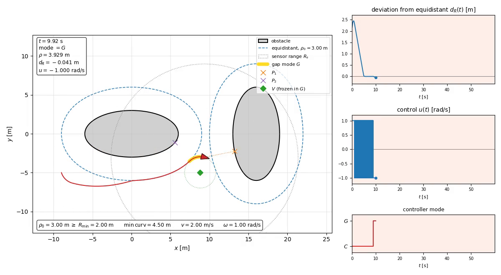

# Модель, задержки и компенсация запаздывания измерения: что сделано и какие результаты

Отчёт описывает состояние стенда на `main` после PR «predictor-stage-1» (ветка `predictor-report-two-ellipses`
добавляет к нему сцену `two_ellipses`, этот отчёт и скрипты экспериментов, ядро не менялось): модель объекта, реактивный закон
обхода, три канала задержки и `PredictorController`, компенсирующий запаздывание измерения. Результаты
получены заново на сцене из **двух перпендикулярных эллипсов**, где закон заходит в режим `G`. Закон
управления не менялся; все числа воспроизводятся командами из раздела 9.

## 0. Краткое резюме

- **Объект и закон.** Машина Дубинса, постоянная скорость, управление — только угловая скорость `ω = ±ω̄`.
  Закон двухрежимный (`C` — следование эквидистанте, `G` — обход «щели» по окружности `R_min`), рулевая
  команда — реле на скользящей переменной. Реле имеет относительную степень 1 и в отсутствие задержек работает
  в дискретном скользящем режиме (на двух эллипсах 31 переключение знака в секунду из максимально возможных 50).
- **Задержки.** Три независимых точки вставки: запаздывание измерения `τ_s`, чистая задержка команды `τ_a (+τ_c)`
  и инерция привода (лаг) `τ`. Любая из них превращает скользящий режим в низкочастотный предельный цикл:
  при `τ_s = 0.2 с` частота переключений падает с 31.45/с до 1.03/с, пик отклонения `|d_R|` растёт с 0.07 до
  1.36 м, минимальный зазор падает с 2.93 до 1.64 м; при `τ_s = 0.8 с` есть столкновение.
- **Предиктор.** `PredictorController` восстанавливает текущее состояние `x(t)` по устаревшему `x(t−τ_s)` и истории
  фактически применённых команд (точная кинематика Дубинса + теневая копия цепочки привода). В номинальном
  случае (модель и `τ_s` известны точно, шума нет) компенсированная траектория **совпадает с беззадержечной
  ровно** (`max|Δposition| = 0.0` м) при всех проверенных `τ_s` от 0.04 до 1.6 с, включая моменты входа и выхода
  из режима `G`.
- **Граница применимости.** Предиктор снимает только запаздывание измерения. При совместных `τ_s + τ_a` и
  `τ_s + лаг` компенсированная траектория совпадает с траекторией «только `τ_a`» / «только лаг» (разница 0.0 м):
  эффект самой задержки команды и лага остаётся.
- **Как читать результат.** Совпадение с беззадержечным прогоном — следствие построения (предиктор
  воспроизводит ту же детерминированную цепочку операций), то есть проверка правильности реализации, а не
  оценка робастности. Робастность к ошибке модели/`τ`, шуму и джиттеру здесь **не измерялась** (раздел 7).

## 1. Объект

Состояние и управление:

$$
\mathbf{x} = (p_x,\ p_y,\ \theta)^\top,\qquad \mathbf{u} = (v,\ \omega)^\top,
\qquad \dot p_x = v\cos\theta,\ \ \dot p_y = v\sin\theta,\ \ \dot\theta = \omega .
$$

При постоянном `u` на интервале используется **точное** решение (дуга окружности; при `ω = 0` — прямая):

$$
\theta(t+\Delta) = \theta + \omega\Delta,\quad
p_x(t+\Delta) = p_x + \tfrac{v}{\omega}\bigl[\sin(\theta+\omega\Delta)-\sin\theta\bigr],\quad
p_y(t+\Delta) = p_y - \tfrac{v}{\omega}\bigl[\cos(\theta+\omega\Delta)-\cos\theta\bigr].
$$

Это отображение `Φ_Δ(x, u)` обладает групповым свойством `Φ_{Δ₁}(Φ_{Δ₂}(x,u),u) = Φ_{Δ₁+Δ₂}(x,u)`, поэтому
при безынерционном приводе траектория не зависит от шага интегрирования. Код: `models/dubins.py`.

**Временна́я организация.** Две сетки: шаг объекта и привода `h = 0.01 с` и период управления
`T = 0.02 с = 2h`. В момент `t_j` регулятор читает `x(t_j)` и выдаёт запрос, который удерживается нулевым
порядком (ZOH) до `t_{j+1}`. В базовом контуре вычислительной задержки нет: команда действует с `t_j`.

**Параметры сцены** (значения по умолчанию `ReactiveCircumnavScenario`):

| параметр | значение | смысл |
|---|---|---|
| `v` | 2 м/с | скорость (постоянная) |
| `ω̄` | 1 рад/с | модуль угловой скорости, `R_min = v/ω̄ = 2 м` |
| `ρ₀` | 3 м | заданное расстояние до препятствия (`ρ₀ ≥ R_min` проверяется перед каждым прогоном) |
| `R_s` | 12 м | радиус датчика |
| `κ`, `δ` | 6, 0.1 м | усиление и ширина зоны в `sat(d_R; ±δ)`; `κδ/v = 0.3` |
| `T`, `h` | 0.02, 0.01 с | период управления, шаг объекта |
| ограничения привода | `v ≤ 2`, `\|ω\| ≤ 2` | жёсткое насыщение (релейная команда `±1` его не задевает) |
| старт | `(−9, −5)` м, курс `−1.268` рад | начальная поза |
| длительность | 60 с | |

## 2. Датчик и закон управления

**Датчик** (`sensors/circular.py`) — всенаправленный, дальность ограничена `R_s`, работает по точной геометрии
препятствий (без лучевой дискретизации), учитывает перекрытие, в том числе самоперекрытие. Он возвращает
только реальные точки границы; «ничего не видно» — это `None`, а не точка на максимальной дальности.

- `P₁` — ближайшая видимая точка границы, `ρ = ‖P₁ − r‖ ≤ R_s`;
- `V = P₁ + (ρ₀ + R_min)·(r − P₁)/‖r − P₁‖` — центр поворотного диска;
- `P₂` — видимая точка, ближайшая к `V`, вне окрестности `P₁` радиуса 1 м.

**Режимы.** `C` (approach/follow) — регулируется `d_R = ρ − ρ₀`, то есть расстояние до эквидистанты ближайшего
препятствия. `G` (gap) — вход при `‖V − P₂‖ < ‖V − P₁‖`: центр `V` замораживается (`V_A`), машина идёт по
окружности радиуса `R_min` вокруг него (`d_R = R_min − ‖r − V_A‖`) до выхода из угла `P₁ V_A P₂`. Режим `G`
переносит машину через «перемычки» между соседними препятствиями. Если `P₁` не найден — курс сохраняется;
если не найден `P₂` — переключение не выполняется.

**Реле.** Скорость постоянна, скорость изменения регулируемой величины `ḋ_R = v·(направление на/от цели)ᵀ·e`
(`e` — единичный вектор курса), и

$$
s = \dot d_R + \kappa\,\mathrm{sat}(d_R;\pm\delta),\qquad
\omega_{\text{cmd}} = \bar\omega\,\mathrm{sign}(s).
$$

Вблизи эквидистанты `ṡ = vω + κvψ` (`ψ` — угол курса к границе): `ω` входит в `ṡ` напрямую, относительная
степень равна 1, и при `vω̄ > |κvψ|` реле даёт идеальный скользящий режим. Именно это свойство разрушают задержки.
Закон — реализация двухрежимного закона из опорной работы (doi:10.1016/j.robot.2024.104649); в этом
репозитории он зафиксирован и не менялся (`controllers/reactive.py`).

## 3. Сцена `two_ellipses`

Два эллипса с полуосями 6 и 3 м (размеры 12×6 м): центры `(0, 0)` и `(16, 0)`, оси повёрнуты на 90° друг к другу
(`angle = 0` и `π/2`).
Зазор между границами — 7 м: эквидистанты (`2ρ₀ = 6 м`) не соприкасаются, остаётся канал шириной 1 м, меньше
`1.5·R_min = 3 м`. Поэтому машина огибает пару «гантелью», а каждую перемычку проходит дугой в режиме `G`.



На кадре: `P₁` (оранжевый крест) лежит на правом эллипсе, `P₂` (фиолетовый) — на левом, зелёный ромб — замороженный
центр `V`, жёлтая дуга — участок в режиме `G`.

**Прогон без задержек** (baseline, 60 с): три захода в `G` — `8.86–10.92`, `30.46–32.48`, `52.46–54.50` с
(по ≈ 2.0 с), доля времени в `G` 0.102, 6 переключений режима (3 входа и 3 выхода), минимальный зазор
2.927 м, пик `|d_R|` во второй половине прогона 0.0732 м (совпадает с `ρ₀ − 2.927 = 0.073` м), 31.45 переключений
знака реле в секунду.

## 4. Задержки в контуре

Путь сигнала: **состояние → датчик → закон → [задержка] → [лаг] → ограничение → объект**.

| канал | поле сценария | формула | реализация |
|---|---|---|---|
| `τ_s` — запаздывание измерения | `sensing_delay` (кратно `T`) | регулятор видит `x(t − τ_s)` | `DelayedController` |
| `τ_a (+τ_c)` — задержка команды | `actuation_delay` (кратно `h`) | `u_прим(t) = u_зад(t − τ_a)` | `DelayedActuator` |
| `τ` — инерция привода | `actuator_time_constant` | `τ·ẏ = u − y` | `LagActuator` |

- **`τ_s`** сдвигает только содержимое состояния; `time` не сдвигается, журнал остаётся на реальных часах. Датчик
  вызывается на переданной регулятору (устаревшей) позе. Закон гибридный, поэтому устаревшая геометрия портит и
  условия переключения `C ↔ G`.
- **`τ_a` и `τ_c` неразличимы**: команда, посчитанная долго, и команда, шедшая долго, доходят до объекта одинаково
  поздно; один блок покрывает оба. Дискретизация точна: `τ_a` кратно `h`, траектории не зависят от `h`. До прихода
  первой команды объект летит прямо на скорости `v`.
- **Лаг** продвигается точным множителем `α = 1 − e^{−h/τ}`, объекту отдаётся среднее значение за шаг. У звена есть
  память, поэтому `h` снова становится (малым) параметром точности.
- **Лаг — не задержка**: фаза `−arctan(Ωτ)` ограничена `−90°`, у чистой задержки она не ограничена; лаг не имеет
  нуля в правой полуплоскости, который есть у аппроксимации Паде задержки.

**Почему задержка ломает реле.** При запаздывании `τ` приведённая модель вблизи поверхности имеет вид
`ṡ = −M·sign(s(t − τ))`, `M = vω̄`: реле реагирует на пересечение поверхности с опозданием, `s` каждый полупериод
перелетает на `Mτ`. Оценки линейного малоуглового приближения: `|s|_max ≈ vω̄τ`, период предельного цикла
`T_lc ≈ 4τ`; та же механика с `τ → T` даёт артефакт дискретизации `|d_R| ≈ 2vT`. Количественно эти оценки
подтверждались только на больших `τ` (`docs/delay_report.md`, разделы 6 и 8); при малых `τ` расхождение
в 2–5 раз.

**Ранее полученные результаты** (`docs/delay_report.md`, один эллипс и кластер, каждый канал по отдельности,
задержки до 0.2 с; на эллипсе `τ_s` дополнительно до 2.56 с): число переключений реле падает с 37/с до ≈ 1/с,
пик `|d_R|` растёт примерно квадратично, затем линейно (`≈ 3.55·τ_s` при больших `τ_s`), в режиме `C` `τ_s` и `τ_a`
ведут себя почти одинаково, лаг мягче (эквивалент `0.4–0.9·τ`), конечный автомат переключений устойчив, но моменты
входа в `G` смещаются накопительно, на эллипсе столкновения начинаются с `τ_s = 1.68 с`. Рисунки: [sweep_ellipse.png](figures/sweep_ellipse.png),
[sweep_cluster.png](figures/sweep_cluster.png), [sweep_ellipse_long.png](figures/sweep_ellipse_long.png).

## 5. Предиктор запаздывания измерения

### 5.1. Идея

Модель и применённые команды известны, поэтому устаревшее состояние можно «довести» до настоящего момента —
это редукция Арштейна / предиктор-обратная связь для линейных систем (Z. Artstein, 1982; O. J. M. Smith, 1957;
M. Krstić, 2009), здесь для нелинейной кинематики, у которой поток `Φ` известен в замкнутой форме. Пусть
`t_j` — текущий момент управления, `m = τ_s/h`, `ũ_i` — команда, **фактически применённая к объекту** на шаге `i`
внутри окна `[t_j − τ_s, t_j)`. Тогда

$$
\hat{\mathbf{x}}_0 = \mathbf{x}(t_j-\tau_s),\qquad
\hat{\mathbf{x}}_{i+1} = \Phi_h(\hat{\mathbf{x}}_i,\ \tilde{\mathbf{u}}_i),\qquad
\hat{\mathbf{x}}(t_j) = \hat{\mathbf{x}}_m .
$$

Закон вызывается на `x̂(t_j)` вместо `x(t_j − τ_s)`. Поскольку внутри закона, помимо реле, вычисляются `P₁`, `P₂`, `V`
и условия `C ↔ G`, они тоже считаются на восстановленной позе, и логика переключения видит то же, что видела бы
без задержки.

### 5.2. Реализация (`controllers/predictor.py`)

`PredictorController(inner, delay_steps, control_period, model, integration_step, actuator_factory)` — обёртка над
законом. На каждом вызове `compute(time, state)`:

1. поступившее состояние кладётся в очередь; якорем `x(t_j − τ_s)` берётся состояние `delay_steps` обновлений назад
   (пока очередь короче — самое первое состояние);
2. якорь прогоняется через `DubinsModel.propagate` по ограниченной очереди **применённых** команд
   (длина `delay_steps·(T/h)`);
3. вызывается `inner.compute(time, x̂)`, `time` не сдвигается;
4. выданная команда пропускается через **теневую** копию цепочки привода (`actuator_factory`, это
   `scenario.build_actuator`) на сетке `h`, а результаты дописываются в историю.

Стадия 1a: без `actuator_factory` история — это собственные команды регулятора по `T` (точно только для
безынерционного привода). Стадия 1b (то, что всегда подставляет `ReactiveCircumnavScenario.run()`): теневой
привод ведёт полную цепочку «задержка → лаг → ограничение». Цепочка — чистая детерминированная функция потока
собственных команд и не читает состояние объекта, поэтому теневая копия остаётся в такте с настоящей по
построению, и `x̂(t_j)` восстанавливается точно даже при `τ_a ≠ 0` и лаге. Пока история ещё короче `τ_s`, якорь —
`x(0)`, а история содержит все команды с нуля, так что восстановление точно с первого такта. При `delay_steps = 0`
предиктор — тождественное отображение. Стоимость: `τ_s/h` вызовов `propagate` на обновление регулятора (20 при
`τ_s = 0.2 с`). Обёртка пробрасывает атрибуты (`.log`, `.mode`, `.switch_count`, …) во внутренний регулятор, как и
`DelayedController`. Включение: `ReactiveCircumnavScenario(sensing_delay=..., sensing_compensation=True)`.

### 5.3. Что предиктор не делает

Он только возвращает регулятору текущее состояние. Он **не** предсказывает, где объект окажется, когда
новая команда пройдёт через `τ_a`/лаг (прогноз по «очереди» уже выданных, но ещё не применённых команд) — это
не реализовано и в коде описано как следующая стадия.

## 6. Эксперименты на сцене `two_ellipses`

### 6.1. Один режим задержки: `τ_s = 0.2 с`

Команда: `circumnav-predictor-compare --shape two_ellipses --delay 0.2`.

| случай | пик `\|d_R\|` (2-я половина), м | переключ./с | доля `G` | мин. зазор, м | переключений режима | `max\|Δposition\|` от baseline, м |
|---|---|---|---|---|---|---|
| baseline (без задержки) | 0.0732 | 31.45 | 0.102 | 2.927 | 6 | 0 |
| `τ_s`, без компенсации | 1.3573 | 1.03 | 0.151 | 1.639 | 6 | 7.75 |
| `τ_s` + предиктор | 0.0732 | 31.45 | 0.102 | 2.927 | 6 | **0.0** |

Эпизоды режима `G` (начало–конец, длительность, с):

| случай | 1-й | 2-й | 3-й |
|---|---|---|---|
| baseline | 8.86–10.92 (2.06) | 30.46–32.48 (2.02) | 52.46–54.50 (2.04) |
| без компенсации | 9.28–12.42 (3.14) | 33.12–35.92 (2.80) | 56.84–59.96 (3.12) |
| предиктор | 8.86–10.92 (2.06) | 30.46–32.48 (2.02) | 52.46–54.50 (2.04) |


- Без компенсации траектория вместо гладкой эквидистанты состоит из «петель», `d_R` колеблется и по модулю
  достигает 1.4 м, реле почти не переключается (≈ 1 раз в секунду против 31). Структура режимов сохраняется (3 захода
  в `G`), но заходы длиннее (2.8–3.1 против 2.0 с), а моменты входа уходят **накопительно**: `+0.42`, `+2.66`,
  `+4.38` с.
- С предиктором кривые baseline и предиктора совпадают, моменты входа и выхода из `G` одинаковы.


Видео (`simulation_output/`, не в git): [baseline](../simulation_output/two_ellipses_baseline.mp4),
[без компенсации](../simulation_output/two_ellipses_uncompensated.mp4),
[с предиктором](../simulation_output/two_ellipses_predictor.mp4) — 1200×660, 20 кадров/с, воспроизведение в 3 раза
быстрее реального времени (20 с на 60 с модельного времени).

### 6.2. Развёртка по `τ_s`

Команда: `circumnav-predictor-report` (метрики те же, что в `circumnav-delay-sweep`).

| `τ_s`, с | пик `\|d_R\|`, м | переключ./с | доля `G` | переключ. режима | зазор, м | `max\|Δposition\|`, м |
|---|---|---|---|---|---|---|
| 0 (baseline) | 0.0732 | 31.45 | 0.102 | 6 | 2.927 | 0 |
| 0.04 | 0.1749 | 6.00 | 0.107 | 6 | 2.743 | 0.88 |
| 0.08 | 0.4049 | 2.67 | 0.113 | 6 | 2.606 | 2.09 |
| 0.10 | 0.7594 | 1.93 | 0.126 | 6 | 2.278 | 3.92 |
| 0.12 | 1.0567 | 1.30 | 0.137 | 6 | 1.970 | 6.17 |
| 0.16 | 1.2580 | 1.07 | 0.133 | 6 | 1.831 | 6.90 |
| 0.20 | 1.3573 | 1.03 | 0.151 | 6 | 1.639 | 7.75 |
| 0.40 | 1.2133 | 0.73 | 0.098 | 5 | 0.992 | 12.1 |
| 0.80 | 3.1087 | 0.50 | 0.152 | 4 | **0.003 (столкновение)** | 26.7 |
| 1.20 | 3.7196 | 0.33 | 0.076 | 4 | 0.698 | 26.3 |
| 1.60 | 5.5195 | 0.27 | 0.026 | 2 | 0.288 | 32.5 |
| **любое из 0.04…1.6 с, с предиктором** | 0.0732 | 31.45 | 0.102 | 6 | 2.927 | **0** |

Строки без компенсации — `DelayedController`; последняя строка — одна на все `τ_s`: с предиктором метрики не
отличаются от baseline ни в одном знаке, а отклонение позиции равно нулю.


- Без компенсации скорость переключений падает с 31 до 0.27 в секунду, а зазор монотонно уменьшается до 0.003 м
  (столкновение, порог 0.05 м) при `τ_s = 0.8 с`. При 1.2 и 1.6 с коллизии по этому порогу нет, но зазор 0.70 и
  0.29 м; поведение при больших `τ_s` немонотонно и зависит от того, как траектория «попадает» в геометрию сцены.
- Пик `|d_R|` — шумная метрика (1.36 м при 0.2 с и 1.21 м при 0.4 с): он зависит от того, как `τ_s` укладывается
  в период `T` и в геометрию заходов в `G`; по отдельным точкам выводов делать не следует.
- Для `τ_s ≥ 0.8 с` произведение `2τ_s·(переключ./с)` равно 0.80, 0.79 и 0.86 — тот же порядок (0.8–0.9), что для
  одиночного эллипса в `docs/delay_report.md`, раздел 6.

### 6.3. Совместные задержки: граница применимости

Все три величины равны 0.1 с. Опорный прогон для сравнения отклонения — тот же, но без `τ_s`.

| конфигурация | пик `\|d_R\|`, м | переключ./с | доля `G` | зазор, м | `max\|Δposition\|` от опорного, м |
|---|---|---|---|---|---|
| без задержек (опорный) | 0.0732 | 31.45 | 0.102 | 2.927 | — |
| `τ_s`, без компенсации | 0.7594 | 1.93 | 0.126 | 2.278 | 3.92 |
| `τ_s` + предиктор | 0.0732 | 31.45 | 0.102 | 2.927 | 0 |
| только `τ_a` (опорный) | 0.7560 | 1.80 | 0.125 | 2.280 | — |
| `τ_s + τ_a`, без компенсации | 1.3895 | 1.07 | 0.146 | 1.650 | 5.34 |
| `τ_s + τ_a` + предиктор | 0.7560 | 1.80 | 0.125 | 2.280 | **0** |
| только лаг (опорный) | 0.4829 | 3.84 | 0.114 | 2.555 | — |
| `τ_s +` лаг, без компенсации | 1.3976 | 1.10 | 0.138 | 1.637 | 5.91 |
| `τ_s +` лаг + предиктор | 0.4829 | 3.84 | 0.114 | 2.555 | **0** |

Предиктор убирает ровно вклад `τ_s`: компенсированный контур совпадает с контуром «только `τ_a`» («только лаг»).
Деградация от `τ_a` (пик 0.756 м, 1.80 переключений/с) и от лага (0.483 м, 3.84/с) остаётся. Заодно видно, что в
этой сцене `τ_s` и `τ_a` одинаковой величины дают почти одинаковые показатели без компенсации (пик 0.759 и 0.756 м,
1.93 и 1.80 переключений/с), как и на одиночном эллипсе, а лаг при том же значении мягче.

## 7. Что результаты показывают и чего не показывают

**Показывают.**
- Реализация предиктора корректна: восстановленное состояние совпадает с истинным, а замкнутый контур с
  компенсацией совпадает с беззадержечным побитово. Это охватывает режимы `C` и `G` и их переключения, а также
  вариант с совместным `τ_a` / лагом (теневой привод).

**Не показывают.**
- **Робастность.** Совпадение «по построению»: предиктор выполняет те же детерминированные операции, что и
  симулятор. Ошибки модели, неточного `τ̂ ≠ τ_s`, шума измерений, джиттера и потерь пакетов в стенде нет.
- **Датчик.** Закон при каждом вызове сам обращается к датчику с переданной позой и **точной** геометрией
  препятствий. Без предиктора это согласованная пара «устаревшая поза + измерения с неё». С предиктором датчик
  вычисляется на восстановленной позе, то есть контур получает ту же информацию, что и беззадержечный. В реальной
  системе пересчитать `P₁`/`P₂` для предсказанной позы возможно только при наличии карты или локальной модели
  препятствий (либо при репроекции устаревшего скана), потому что `P₁` и `P₂` зависят от точки обзора. Стенд этого
  не моделирует.
- **`τ_a` и лаг.** Прогноз по очереди команд (компенсация самих `τ_a` и лага) не реализован.
- **Охват.** Одна сцена, одна стартовая поза, один набор коэффициентов закона, одно значение `T`, прогоны по 60 с,
  случайности нет (результат детерминирован, повторение даёт те же числа). Кинематическая модель без динамики
  объекта; препятствия статичны.

## 8. Тесты

Прогон `PYTEST_DISABLE_PLUGIN_AUTOLOAD=1 PYTHONPATH=src python3 -m pytest -q -p no:cacheprovider`:
**104 passed за 42.5 с** (ветка `predictor-report-two-ellipses`, 2026-10-30). Относящиеся к теме:

| файл | что проверяет |
|---|---|
| `tests/test_actuator_dynamics.py` | точный сдвиг при задержке, точная ступенчатая реакция лага и среднее по интервалу, сборка цепочки в сценарии |
| `tests/test_delayed_controller.py` | сдвиг состояния на `delay_steps` обновлений, `time` не сдвигается, проброс атрибутов, кратность `τ_s` периоду `T` |
| `tests/test_predictor_controller.py` | точное восстановление состояния, совпадение с baseline, точность при совместных `τ_s + τ_a` и `τ_s +` лаг, совпадение с «только `τ_a`»/«только лаг», тождественность при `delay_steps = 0`, расхождение без компенсации |
| `tests/test_demo_scenes.py` | сцена `two_ellipses`: перпендикулярность, зазор 7 м, заход в `G` без столкновения |

## 9. Воспроизведение

Из корня репозитория (`PYTHONPATH=src` не нужен после `pip install -e .`):

```bash
# 1 режим задержки (τ_s = 0.2 с): 3 видео + сводный рисунок
PYTHONPATH=src python3 -m circumnav.examples.predictor_compare --shape two_ellipses --delay 0.2

# развёртка по τ_s, совместные задержки, эпизоды G, окно вокруг захода в G
PYTHONPATH=src python3 -m circumnav.examples.predictor_report > simulation_output/two_ellipses_predictor_report.log
```

Результаты:

| файл | содержание |
|---|---|
| `simulation_output/two_ellipses_{baseline,uncompensated,predictor}.mp4` | анимации (не в git) |
| `simulation_output/two_ellipses_predictor_sweep.{npz,png}` | данные и рисунок развёртки |
| `simulation_output/two_ellipses_predictor_report.log`, `predictor_compare_two_ellipses_0p2.log` | таблицы, использованные выше |
| `docs/figures/two_ellipses_*.png` | рисунки этого отчёта |

Код: `models/dubins.py`, `models/actuator.py` (задержка, лаг, насыщение), `controllers/reactive.py` (закон),
`controllers/delayed.py`, `controllers/predictor.py`, `scenarios/reactive.py` (сборка), `examples/predictor_compare.py`
и `examples/predictor_report.py` (эксперименты).

## Литература

1. Опорная реализация двухрежимного закона: doi:10.1016/j.robot.2024.104649 (ссылка из README).
2. Z. Artstein, «Linear systems with delayed controls: a reduction», IEEE Trans. Automat. Control, 27(4), 1982.
3. O. J. M. Smith, «Closer control of loops with dead time», Chemical Engineering Progress, 53(5), 1957.
4. M. Krstić, *Delay Compensation for Nonlinear, Adaptive, and PDE Systems*, Birkhäuser, 2009.
