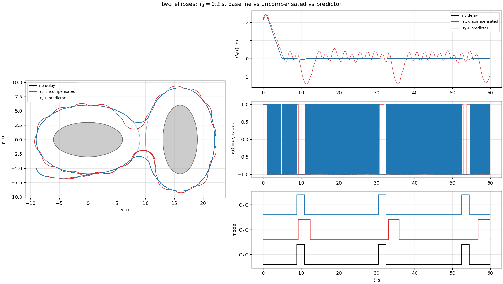
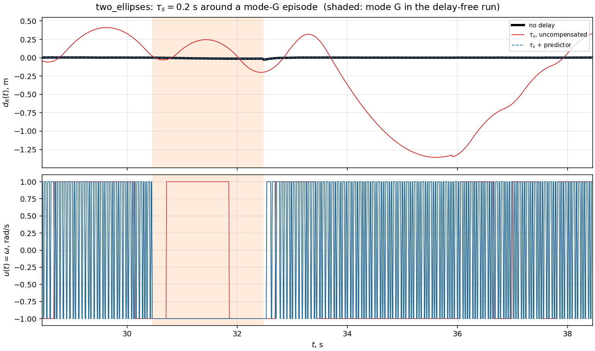
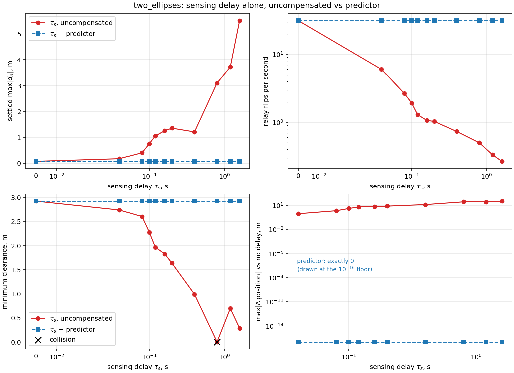

# Модель стенда и работа предиктора запаздывания измерения

Подробное описание того, **что сейчас реализовано** в стенде (объект, привод, датчик, закон, временна́я
организация, три канала задержки) и **как в этот контур встраивается и работает `PredictorController`**.
Все числа получены прогоном кода ветки `predictor-report-two-ellipses` (2026-10-30), закон управления не менялся.
Краткие результаты и таблицы по сцене `two_ellipses` — в [predictor_report.md](predictor_report.md); здесь акцент на
устройстве и механизме.

Обозначения как в `AGENTS.md`: `v` — скорость, `ω̄` — модуль угловой скорости (реле `±ω̄`), `R_min = v/ω̄`,
`ρ₀` — заданный отступ, `ρ` — расстояние до ближайшей видимой точки, `d_R` — регулируемая величина (расстояние
до эквидистанты), `R_s` — радиус датчика, `h` — шаг интегрирования, `T = N·h` — период управления,
`τ_s` — запаздывание измерения, `τ_a (+τ_c)` — задержка команды, `τ` — инерция привода.

## 0. Что нужно знать, прочитав только этот раздел

- Контур: **плата (машина Дубинса) → датчик → закон → [предиктор] → ZOH → привод (задержка → лаг → ограничение)
  → плата**. Решение принимается каждые `T = 0.02 с`, плата интегрируется точно каждые `h = 0.01 с`.
- Закон — двухрежимное реле на скользящей переменной, он **заморожен**; всё остальное (задержки, привод,
  предиктор) добавлено *вокруг* него.
- Запаздывание измерения `τ_s` означает, что закон видит позу `x(t − τ_s)`. При `τ_s = 0.2 с` поза отстаёт
  в среднем на `0.399 м` по положению (`≈ v·τ_s = 0.4 м`) и на `0.2 рад` по курсу (`= ω̄·τ_s`).
- Предиктор берёт устаревшую позу как «якорь» и **проигрывает вперёд** точную кинематику Дубинса по тем командам,
  которые *реально были применены* к плате за эти `τ_s`. Результат — текущая поза `x̂(t)`, и именно она подаётся в
  закон: и в реле, и в условия переключения `C ↔ G`, и в датчик.
- Проигрывание точное, потому что (а) решение Дубинса для постоянной команды замкнутое и обладает групповым свойством,
  а (б) цепочка привода детерминированна и не читает состояние платы, поэтому «теневая» копия привода внутри
  предиктора остаётся в такте с настоящей. Поэтому в номинальном случае `x̂(t) ≡ x(t)` без ошибки
  (измерено: `0` м, `0` рад на всех 3000 обновлениях).
- Предиктор снимает **только** `τ_s`. `τ_a` и лаг он не компенсирует; робастность (ошибка модели, шум, неточное
  `τ̂`) в стенде **не измерялась** (раздел 9).

## 1. Структура контура

```
                      ┌───────────── controller (период T = 0.02 с) ─────────────┐
 x(t_j) ──► [очередь] ──► якорь x(t_j − τ_s) ──► [повтор dubins по применённым] ──► x̂(t_j)
 (плата)    (deque)                                    команды (τ_s/h шагов)           │
                                                                                       ▼
                                          ┌──────────── ReactiveCircumnavController ─────────────┐
                                          │ датчик(x̂) → P₁, P₂ → V → режим C/G → реле u = ±ω̄    │
                                          └───────────────────────────┬──────────────────────────┘
                                                                      │ запрос u(t_j), v = const
                  ┌───────────────────────────────────────────────────┴──────────┐
                  ▼                                                              ▼
        ZOH до t_{j+1}  в движке                         теневой привод внутри предиктора
                  │                                      (та же цепочка, на сетке h) ──► история применённых
                  ▼
   привод: DelayedActuator(τ_a) → LagActuator(τ) → IdealActuator (clip), на сетке h
                  │ применённая команда ũ(t)
                  ▼
   DubinsModel.propagate (точная дуга за h) ──► x(t + h)
```

Без компенсации блок «[очередь] … x̂» заменяется на `DelayedController`: из очереди берётся только `x(t_j − τ_s)`
и подаётся в закон как есть. Без задержек и то, и другое отсутствует — закон получает `x(t_j)`.

Сборка — `ReactiveCircumnavScenario.run()` (`scenarios/reactive.py`): `sensing_delay = 0` → голый закон;
`sensing_delay > 0` и `sensing_compensation = False` → `DelayedController`; `True` → `PredictorController` с
`actuator_factory = scenario.build_actuator`.

## 2. Объект: машина Дубинса

Состояние `x = (p_x, p_y, θ)` в метрах и радианах (СИ, ось `x` вперёд, `θ` положителен против часовой), команда
`u = (v, ω)`:

$$
\dot p_x = v\cos\theta,\qquad \dot p_y = v\sin\theta,\qquad \dot\theta = \omega .
$$

`DubinsModel.propagate(state, command, dt)` (`models/dubins.py`) — **точное** решение для команды, постоянной на `dt`
(дуга окружности, при `|ω| < 10⁻¹⁰` — прямая):

$$
\theta^+ = \theta+\omega\Delta,\qquad
p_x^+ = p_x+\tfrac v\omega[\sin\theta^+-\sin\theta],\qquad
p_y^+ = p_y-\tfrac v\omega[\cos\theta^+-\cos\theta],
$$

курс приводится к `[−π, π)`. Свойство `Φ_{Δ₁}(Φ_{Δ₂}(x,u),u) = Φ_{Δ₁+Δ₂}(x,u)` означает: для безынерционного
привода траектория не зависит от `h`. Именно на нём держится точность предиктора, поэтому `propagate` нельзя заменять
на Эйлера или Рунге–Кутту.

Ограничения (`DubinsLimits`): `0 ≤ v ≤ 2 м/с`, `|ω| ≤ 2 рад/с`. Релейная команда `±1 рад/с` ограничений не задевает,
но фиксирует `R_min = v/ω̄ = 2 м`.

## 3. Привод: три звена и порядок

`Actuator.apply(command, dt)` вызывается движком **на каждом шаге интегрирования** с удерживаемым запросом, поэтому
звенья с памятью продвигаются ровно на `h` за вызов.

| звено | модель | реализация | параметр |
|---|---|---|---|
| ограничение | `clip(v, [0, v_max])`, `clip(ω, ±ω_max)` | `IdealActuator` | `max_speed`, `max_yaw_rate` |
| лаг | `τ·ẏ = u − y` на обоих каналах | `LagActuator` | `actuator_time_constant` |
| чистая задержка | `ũ(t) = u(t − τ_a)` | `DelayedActuator` | `actuation_delay` (кратно `h`) |

Порядок в цепочке: **запрос → задержка → лаг → ограничение → плата** (`build_actuator`). До прихода первой команды
через линию плата получает «крейсерскую» команду `(v, 0)`.

- Лаг продвигается точным множителем `α = 1 − e^{−h/τ}`, плате отдаётся *среднее* значение `y` за шаг, чтобы приращение
  курса было точным. У лага есть память, поэтому траектория слабо зависит от `h`.
- `τ_a` и вычислительная задержка `τ_c` в этом контуре неразличимы, один блок покрывает оба.
- Лаг — не задержка: его фаза `−arctan(Ωτ)` ограничена `−90°`.

Ключевое свойство для предиктора: вся цепочка — **чистая детерминированная функция потока запросов**, она не читает
состояние платы.

## 4. Датчик

`CircularVisibilitySensor(max_range = R_s, exclusion_distance = 1 м, check_occlusion = True)`
(`sensors/circular.py`): всенаправленный (2π), дальность `R_s = 12 м`, **точная геометрия** препятствий, без лучевой
дискретизации. Возвращает только реальные точки границы; «ничего не видно» — это `None` (точка на максимальной
дальности никогда не выдумывается). Скрытыми считаются задняя сторона самого тела и точки, закрытые другим
препятствием.

- `P₁` — ближайшая видимая точка границы, `ρ = ‖P₁ − r‖ ≤ R_s`.
- `V = P₁ + (ρ₀ + R_min)·(r − P₁)/‖r − P₁‖` — центр поворотного диска.
- `P₂` — видимая точка, ближайшая к `V`, вне окрестности `P₁` радиуса 1 м.

Датчик зависит от позы, с которой он «смотрит». Это важно для задержки: поза, переданная закону, определяет, какие
`P₁`, `P₂` будут найдены (раздел 7.4).

## 5. Закон управления (заморожен)

`ReactiveCircumnavController` (`controllers/reactive.py`), на каждом обновлении:

1. `P₁` из датчика. Если нет — курс сохраняется (`ω = 0`), в журнал пишется `NaN`.
2. `V` и `P₂`.
3. Переключение режима.
   - `C → G`, когда `‖V − P₂‖ < ‖V − P₁‖`; тогда `V` **замораживается** как `V_A`.
   - `G → C`, когда машина выходит из угла `P₁ V_A P₂` (проверяется только если `P₂` найден).
4. Регулируемая величина: в режиме `C` — `d_R = ρ − ρ₀`; в режиме `G` — `d_R = R_min − ‖r − V_A‖`.
5. Скорость изменения: `ḋ_R = v·(направление на/от цели)ᵀ·e`, `e = (cos θ, sin θ)`.
6. Реле:

$$
s = \dot d_R + \kappa\,\mathrm{sat}(d_R;\pm\delta),\qquad u = \bar\omega\,\mathrm{sign}(s),\qquad v=\text{const}.
$$

В коде `κ = dead_zone_gain`, `δ = dead_zone`. В сценарии `κ = 6`, `δ = 0.1 м`, т. е. `κδ/v = 0.3`
(значение по умолчанию конфига `0.025` сходится слишком медленно).

Вблизи эквидистанты `ṡ = vω + κvψ` (`ψ` — угол курса к границе), `ω` входит напрямую → относительная степень
1 → идеальный скользящий режим при `vω̄ > |κvψ|`. В базовом прогоне это 31.45 смен знака в секунду из максимально
возможных 50 (`1/T`). Именно скользящий режим разрушают задержки.

Артефакт дискретизации: `d_R(t)` имеет «клювы» размера ≈ `2vT = 0.08 м` на переключениях режима (в базе пик `0.0732 м`);
это не дефект закона.

## 6. Сцена и параметры

Сцена `two_ellipses` (`examples/reactive_circumnav.build_obstacle`): два эллипса с полуосями 6 и 3 м, центры
`(0, 0)` и `(16, 0)`, повёрнуты на 90° друг к другу. Зазор между границами 7 м > `2ρ₀ = 6 м`: эквидистанты не касаются,
остаётся канал 1 м < `1.5·R_min = 3 м`. Поэтому машина идёт «гантелью», а каждую перемычку проходит дугой в
режиме `G`.

| параметр | значение | параметр | значение |
|---|---|---|---|
| `v` | 2 м/с | `R_s` | 12 м |
| `ω̄` | 1 рад/с | `κ`, `δ` | 6; 0.1 м |
| `R_min` | 2 м | `T`, `h` | 0.02 с, 0.01 с |
| `ρ₀` | 3 м (проверяется `ρ₀ ≥ R_min`) | старт | `(−9, −5)` м, курс `−1.268` рад |
| лимиты | `v ≤ 2`, `\|ω\| ≤ 2` | длительность | 60 с |

Прогон без задержек: три захода в `G` — `8.86–10.92`, `30.46–32.48`, `52.46–54.50` с, доля `G` `0.102`, 6 переключений
режима, минимальный зазор `2.927 м`.

## 7. Как работает предиктор

### 7.1. Что ломает задержка измерения

`DelayedController` кладёт каждое состояние в очередь и отдаёт закону состояние `delay_steps` обновлений назад
(`delay_steps = τ_s/T = 10` при `τ_s = 0.2 с`). `time` не сдвигается, журнал идёт по реальным часам. Закон при этом
остаётся согласованным сам с собой — он просто получает *прошлую* позу и считает датчик, реле и условия `C ↔ G` для неё.
Измерено на 3000 обновлениях (`τ_s = 0.2 с`):

| что подаётся в закон | `‖x_seen − x_true‖`, м (макс / среднее) | `\|θ_seen − θ_true\|`, рад (макс / среднее) |
|---|---|---|
| без задержки | 0 / 0 | 0 / 0 |
| `DelayedController` | 0.3998 / 0.3987 | 0.200 / 0.178 |
| `PredictorController` | **0 / 0** | **0 / 0** |

Ошибка нарастает линейно за первые `m` обновлений (начальная фаза): `0.040`, `0.200`, `0.399` м после 1-го, 5-го,
10-го обновления, потом стоит на `v·τ_s`. Это и есть то, что «видит» закон; реле реагирует на пересечение поверхности
с опозданием, и скользящий режим превращается в предельный цикл.

### 7.2. Идея

Известны модель, команды, фактически применённые к плате, и устаревшая поза. Значит, текущую позу можно
восстановить. Пусть `m = τ_s/h` — число шагов `h` в окне, `ũ_i` — команда, **применённая к плате** на шаге `i`
окна `[t_j − τ_s, t_j)`. Тогда

$$
\hat{\mathbf x}_0 = \mathbf x(t_j-\tau_s),\qquad
\hat{\mathbf x}_{i+1} = \Phi_h(\hat{\mathbf x}_i,\ \tilde{\mathbf u}_i),\qquad
\hat{\mathbf x}(t_j)=\hat{\mathbf x}_m .
$$

Это редукция Арштейна (предиктор-обратная связь, Z. Artstein, 1982; O. J. M. Smith, 1957; M. Krstić, 2009) для
нелинейной кинематики, у которой поток `Φ` известен в замкнутой форме.

### 7.3. Один такт `compute(time, state)`

Для `τ_s = 0.2 с`: `delay_steps = 10` обновлений, `substeps_per_period = T/h = 2`, длина истории применённых команд
`10·2 = 20` шагов.

```
t_j − 0.20 с                                                         t_j (сейчас)
   │◄────────────── 10 обновлений = 20 шагов h ───────────────────►│
   x(t_j−τ_s) ─Φ_h(ũ₀)─► ─Φ_h(ũ₁)─► … ─Φ_h(ũ₁₈)─► ─Φ_h(ũ₁₉)─► x̂(t_j)
   (якорь, из очереди)        применённые команды из истории        (подаётся в закон)
```

1. **Очередь.** Пришедшее состояние кладётся в `_state_history`. Якорем берётся состояние `delay_steps` обновлений
   назад (`popleft`); пока очередь короче, якорем остаётся самое первое состояние `x(0)`.
2. **Проигрывание.** От якоря `DubinsModel.propagate` последовательно проходит по `_applied_history` (до 20 шагов `h`).
3. **Закон.** `inner.compute(time, x̂)`: датчик, `P₁`, `P₂`, `V`, переключение `C/G` и реле считаются на `x̂`.
4. **Теневой привод.** Выданная команда проходит через `substeps` вызовов `_shadow_actuator.apply(command, h)`.
   Каждый результат `output.applied` дописывается в `_applied_history` (deque с `maxlen = 20`, самые старые вытесняются).

Порядок совпадает с движком: запрос на `[t_j, t_{j+1})` добавляется в историю уже после вызова закона, поэтому в
проигрывании на такте `j` его нет — ему и не за что там быть: к моменту `t_j` он ещё не применялся. На такте `j+1` он
попадает в окно.

### 7.4. Почему проигрывание точное

- **Замкнутое решение.** `Φ_h` — точная дуга, и `Φ_{h}∘Φ_{h} = Φ_{2h}`: проигрывание по шагам `h` даёт ту же позу,
  что и сама плата (она шагает тем же `propagate` с тем же `h`).
- **Теневой привод.** В версии без `actuator_factory` («стадия 1a») история — это собственные команды предиктора по `T`:
  метод точен, только если реальный привод безынерционен и ненасыщен. «Стадия 1b» (всегда подставляется сценарием) заводит
  отдельную копию цепочки привода, собранную той же `build_actuator`, и шагает ей на сетке `h` по тому же потоку
  запросов. Цепочка не читает состояние платы, поэтому теневая и настоящая остаются в такте по построению, и `x̂` точен
  и при `τ_a ≠ 0`, и при лаге.
- **Начальная фаза.** Пока прошло меньше `τ_s`, якорь — `x(0)`, а история содержит все команды с нуля (она ещё короче
  своего `maxlen`), так что восстановление точно с первого же такта.
- **`delay_steps = 0`** — тождественное отображение: проигрывать нечего.

Следствие: совпадение с беззадержечным прогоном (`max|Δposition| = 0.0` м) — **свойство построения**, проверка
правильности реализации, а не оценка робастности. Предиктор повторяет те же детерминированные операции, что симулятор.

### 7.5. Что предиктор подаёт датчику

Закон при каждом вызове сам обращается к датчику с той позой, которую получил. С предиктором это `x̂ ≡ x`, поэтому датчик
находит те же `P₁` и `P₂`, что и без задержки, и переключения `C ↔ G` происходят в те же моменты (эпизоды `G`
`8.86–10.92`, `30.46–32.48`, `52.46–54.50` с совпадают с базой). Без компенсации моменты входа смещаются накопительно
(`+0.42`, `+2.66`, `+4.38` с), а заходы удлиняются (`2.8–3.1` с против `2.0` с).

Но в реальной системе пересчитать `P₁`, `P₂` для *предсказанной* позы можно лишь при наличии карты или локальной модели
препятствий (или репроекции устаревшего скана): они зависят от точки обзора. Стенд этого не моделирует — датчик здесь
идеальный и считает по точной геометрии на любой позе.

### 7.6. Стоимость и границы

- `τ_s/h` вызовов `propagate` на обновление (20 при `τ_s = 0.2 с`; 160 при `1.6 с`) плюс `T/h = 2` вызова теневого привода.
- Не делает: **не** предсказывает, где объект окажется, когда *новая* команда пройдёт через `τ_a`/лаг (прогноз по очереди
  уже выданных, но ещё не применённых команд). Это следующая стадия, в коде не реализована.

## 8. Результаты (сцена `two_ellipses`, 60 с, `τ_s = 0.2 с`)

Метрики по второй половине прогона (`SETTLED_FRACTION = 0.5`) и переходному участку; одна сцена, одна стартовая поза,
результат детерминирован.

| метрика | без задержки | `τ_s`, без компенсации | `τ_s` + предиктор |
|---|---|---|---|
| пик `\|d_R\|` (установившийся), м | 0.0732 | 1.3573 | 0.0732 |
| RMS `d_R`, м | 0.0094 | 0.5134 | 0.0094 |
| смещение (среднее `d_R`), м | −0.0016 | −0.1158 | −0.0016 |
| `max\|s\|` | 0.425 | 1.847 | 0.425 |
| смен знака реле, 1/с | 31.45 | 1.03 | 31.45 |
| доля режима `G` | 0.102 | 0.151 | 0.102 |
| доля «ничего не видно» | 0 | 0 | 0 |
| переключений режима | 6 | 6 | 6 |
| минимальное расстояние до тела `min ρ`, м | 2.927 | 1.639 | 2.927 |
| минимальный зазор `min(ρ) − ρ₀`, м | −0.073 | −1.361 | −0.073 |
| столкновение | нет | нет | нет |
| время, после которого `\|d_R\| ≤ 0.1`, с | 4.76 | не наступает (до конца прогона) | 4.76 |
| пик `\|d_R\|` за первые 10 с (переходный), м | 2.451 | 2.451 | 2.451 |
| `max\|Δposition\|` от базы, м | — | 7.75 | **0.0** |

Переходный пик `2.451 м` — начальное отклонение от эквидистанты, одинаковое во всех трёх прогонах (на этой сцене и
стартовой позе задержка в первые 10 с на пик не влияет, она сказывается на установившемся режиме). Отрицательный зазор
в базе, `−0.073 м`, — тот же «клюв» дискретизации из раздела 5, а не вторжение в запретную зону. Расстояние до тела считается
по истинной геометрии, а не по датчику.

Развёртка по `τ_s` (без компенсации): частота смены знака падает с 31.45 до 0.27 в секунду, пик `|d_R|` растёт с 0.07
до 5.5 м, при `τ_s = 0.8 с` есть столкновение (зазор `0.003 м`). С предиктором метрики во всех 11 точках
`τ_s ∈ {0.04, 0.08, 0.10, 0.12, 0.16, 0.20, 0.40, 0.80, 1.20, 1.60} с` (10 точек) совпадают с базой во всех
приведённых знаках.







Видео (`simulation_output/`, не в git; 1200×660, 20 кадров/с, 20 с на 60 с модельного времени):
`two_ellipses_baseline.mp4`, `two_ellipses_uncompensated.mp4`, `two_ellipses_predictor.mp4`. Файлы `baseline` и
`predictor` совпадают по размеру до байта (650014), как и должно быть при идентичных траекториях.

### Совместные задержки: граница применимости (все значения 0.1 с)

| конфигурация | пик `\|d_R\|`, м | 1/с | зазор, м | `max\|Δposition\|` от опорного, м |
|---|---|---|---|---|
| `τ_a` только (опорный) | 0.7560 | 1.80 | 2.280 | — |
| `τ_s + τ_a`, без компенсации | 1.3895 | 1.07 | 1.650 | 5.34 |
| `τ_s + τ_a` + предиктор | 0.7560 | 1.80 | 2.280 | **0** |
| лаг только (опорный) | 0.4829 | 3.84 | 2.555 | — |
| `τ_s +` лаг, без компенсации | 1.3976 | 1.10 | 1.637 | 5.91 |
| `τ_s +` лаг + предиктор | 0.4829 | 3.84 | 2.555 | **0** |

Предиктор убирает ровно вклад `τ_s`. Контур с компенсацией совпадает с контуром «только `τ_a`» («только лаг»), а
деградация от самих `τ_a` и лага остаётся.

## 9. Что результаты показывают и чего не показывают

**Показывают.**
- Реализация предиктора корректна: восстановленная поза совпадает с истинной (0 м, 0 рад на 3000 обновлениях), замкнутый
  контур совпадает с беззадержечным, включая режимы `C` и `G`, их переключения и совместные `τ_a` / лаг.
- Механизм деградации без компенсации в этой сцене: устаревшая поза (`≈ v·τ_s`) → реле опаздывает → предельный цикл
  вместо скользящего режима, и условия `C ↔ G` срабатывают на устаревшей геометрии.

**Не показывают.**
- **Робастность.** Нет ошибки модели, неточного `τ̂ ≠ τ_s`, шума, джиттера, потерь пакетов. Предиктор здесь знает `τ_s`,
  модель и применённые команды точно.
- **Датчик.** Нет карты или локальной модели препятствий: пересчёт `P₁/P₂` на предсказанной позе в реальной системе
  отдельная задача.
- **`τ_a` и лаг.** Прогноз по очереди команд не реализован.
- **Охват.** Одна сцена, одна стартовая поза, один набор коэффициентов, одно `T`, статичные препятствия, кинематическая
  модель без динамики.
- **Оценка по теории.** Оценки `|s|_max ≈ vω̄τ` и периода предельного цикла `T_lc ≈ 4τ` при малых `τ` расходятся с
  измерением в 2–5 раз (здесь `max|s|` = 1.85 против `vω̄τ_s = 0.4`); количественно они подтверждены только на больших `τ`
  (`docs/delay_report.md`).

**Что дальше (по возрастанию отличий от текущего кода).**
1. Робастность: возмущение `τ̂ = τ_s(1 ± ε)`, ошибка скорости, шум позы; метрики те же, база та же.
2. Компенсация `τ_a` и лага (прогноз по очереди выданных, но ещё не применённых команд, «стадия 1c»).
3. Пересчёт `P₁/P₂` по карте или локальной модели вместо идеального датчика.

## 10. Воспроизведение

```bash
# тесты ветки: 104 passed за 42.5 с
PYTEST_DISABLE_PLUGIN_AUTOLOAD=1 PYTHONPATH=src python3 -m pytest -q -p no:cacheprovider

# один режим задержки (τ_s = 0.2 с): 3 видео и сводный рисунок
PYTHONPATH=src python3 -m circumnav.examples.predictor_compare --shape two_ellipses --delay 0.2

# развёртка по τ_s, совместные задержки, эпизоды G, окно вокруг захода в G
PYTHONPATH=src python3 -m circumnav.examples.predictor_report \
    > simulation_output/two_ellipses_predictor_report.log
```

Перепрогон 2026-10-30 дал в таблицах разделов 8 те же числа, что и раньше, до последнего знака; рисунки
`docs/figures/two_ellipses_*.png` совпадают по размеру с перегенерированными.

Оценка «что видит закон» (раздел 7.1) и полные метрики раздела 8 считались временным скриптом на публичном API
(в репозиторий не входит): обёртка над законом запоминает позу, с которой вызван `compute`, а ошибка берётся относительно
`result.state[k]` на индексе `k = round(t / h)`; метрики — `circumnav.examples.delay_sweep.run_point`.

| файл | содержимое |
|---|---|
| `controllers/predictor.py` | `PredictorController` |
| `controllers/delayed.py` | `DelayedController` |
| `models/dubins.py`, `models/actuator.py` | плата, привод |
| `controllers/reactive.py` | закон (заморожен) |
| `scenarios/reactive.py` | сборка контура, флаг `sensing_compensation` |
| `examples/predictor_compare.py`, `examples/predictor_report.py` | эксперименты |
| `tests/test_predictor_controller.py` | точность восстановления, совпадение с базой, совместные задержки |

## Литература

1. Опорная реализация двухрежимного закона: doi:10.1016/j.robot.2024.104649.
2. Z. Artstein, «Linear systems with delayed controls: a reduction», IEEE Trans. Automat. Control, 27(4), 1982.
3. O. J. M. Smith, «Closer control of loops with dead time», Chemical Engineering Progress, 53(5), 1957.
4. M. Krstić, *Delay Compensation for Nonlinear, Adaptive, and PDE Systems*, Birkhäuser, 2009.
